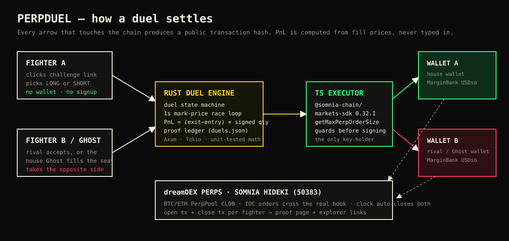
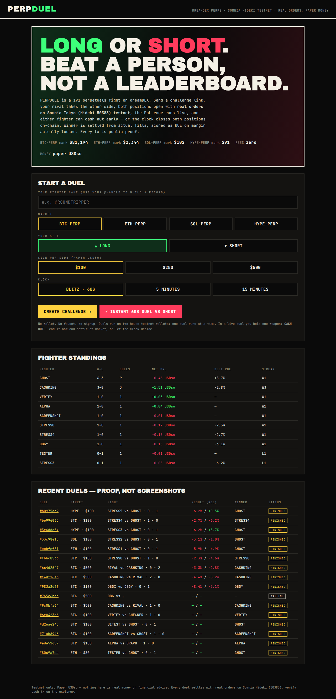
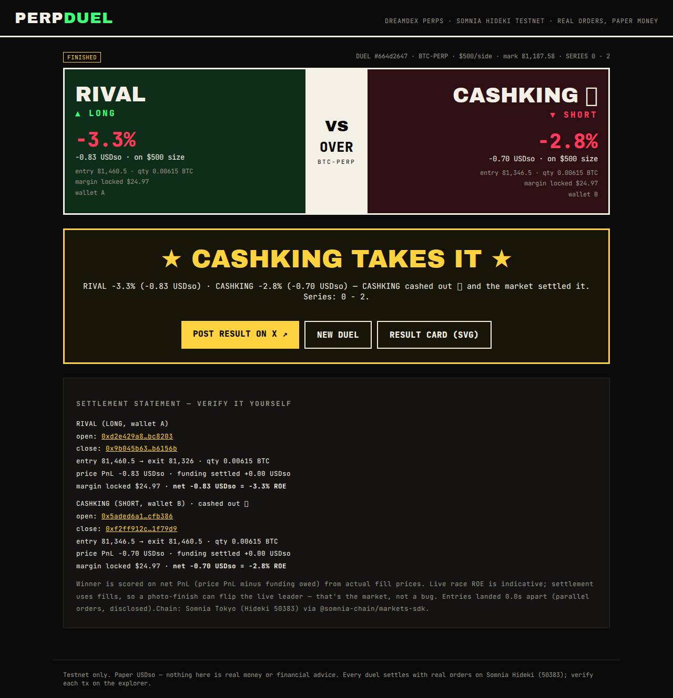

# PERPDUEL

**Long or short. Beat a person, not a leaderboard.**

PERPDUEL is a 1v1 perpetuals duel on dreamDEX. Send a challenge link, your rival takes the other side, both positions open with **real orders on Somnia Hideki testnet**, the PnL race runs live, and the clock closes both positions on-chain. The winner gets a shareable card; every transaction is public proof.

`Category: consumer perps` · dreamDEX Perps Builder Bounty (MVP track) · Somnia Hideki testnet (chain 50383)



---

## The problem

Perps Arena proved thousands of traders will compete on a weekly ROI leaderboard and post PnL cards for quests. But a leaderboard is abstract: you never beat *anyone in particular*, and a PnL screenshot proves nothing — anyone can fake one.

dreamDEX's own Week 2 Arena post named the behaviour: only 2 in 10 trades were ever in profit, and 35% of those still closed red. Traders don't lack charts. They lack a short, personal, verifiable contest with a clock that forces the close.

## What PERPDUEL does

1. **Create** — pick a fighter name (your @handle builds a record), BTC/ETH/SOL/HYPE-PERP, LONG or SHORT, size ($100 / $250 / $500 per side) and a clock (60s Blitz / 5m / 15m). You get a challenge link. No wallet, no faucet, no signup.
2. **Accept** — a rival opens the link and takes the opposite side (or you fight the **Ghost**, a disclosed house-wallet opponent, so a duel always runs solo in under 10 seconds).
3. **Fight** — the Rust duel engine places two real IOC orders in parallel on the dreamDEX CLOB (one per house wallet), then races ROE — return on the margin each position actually locked — over a live price tape with both entry lines and liquidation levels.
4. **Decide** — either fighter can **CASH OUT (chicken)** at any moment: both positions close immediately at market and settle. Bank a lead, cut a loss, deny a comeback. Only the fighter's own secret token (issued to their browser) can pull this trigger.
5. **Settle** — at zero (or on a cash-out), both positions close with real opposite orders. A settlement statement breaks out price PnL, funding settled, margin locked, and **net ROE** — all from actual fill prices. Winner, result card, proof page with all four transaction hashes.
6. **Run it back** — REMATCH swaps sides and reserves the rival's seat; a running series score (first blood counts — CASHKING leads RIVAL 2–0 in our test series) and a public fighter standings board (W/L, net PnL, best ROE, streaks) give the loop memory.

### Why this is the MVP worth using

- **Viral by construction:** the challenge link *is* distribution; the result card *is* the X post (judges score communication — the product generates it). Rematch and rivalry are one click.
- **Proof over claims:** nothing is a screenshot. Every duel on the home board links to open/close txs on the Hideki explorer.
- **Zero-friction judging:** a judge clicks a link and is in a live duel in seconds. Every competing bot we found in this bounty requires a funded wallet, a linked bot key, or a Telegram setup first.

## Live proof (real duels already settled)

| Duel | Fight | Result | Proof |
|---|---|---|---|
| `9c0bfa64` | CASHKING (LONG) vs RIVAL (SHORT), BTC · $500/side | CASHKING **+3.30**, RIVAL −4.81 USDso | [A open](https://smk-dev-markets-explorer-hideki-euw4-uzavbo36ra-ez.a.run.app/tx/0x8b82dda4a184a0955c7bfe2bd2459404cdafc6d6c06a2a50a0f2f7fe4012c81a) · [A close](https://smk-dev-markets-explorer-hideki-euw4-uzavbo36ra-ez.a.run.app/tx/0x097c394b7c144bc7a41d0de061a75dd8e00e9303ded0c8d9ff2475417191ff56) · [B open](https://smk-dev-markets-explorer-hideki-euw4-uzavbo36ra-ez.a.run.app/tx/0xd440e4b475354fa3c01642c8daa692310afa9b7482842d8acd2894763fc643cb) · [B close](https://smk-dev-markets-explorer-hideki-euw4-uzavbo36ra-ez.a.run.app/tx/0x8141328680a22ef926021abc51df77ffd870dca1d020121e184a24beaf0255fb) |
| `ada52657` | ALPHA (SHORT) vs BRAVO (LONG), BTC | ALPHA **+0.036**, BRAVO −0.058 USDso | [A open](https://smk-dev-markets-explorer-hideki-euw4-uzavbo36ra-ez.a.run.app/tx/0xe649336bc7d7ef6f2b9b784b9afc80ca743ce281ca35d7ad1ef4c49fb8e76aae) · [A close](https://smk-dev-markets-explorer-hideki-euw4-uzavbo36ra-ez.a.run.app/tx/0x420962cd4ccd02da64439e91e9d033699c484c9a988c2edf617da1929fc776f9) · [B open](https://smk-dev-markets-explorer-hideki-euw4-uzavbo36ra-ez.a.run.app/tx/0x0b68f901a361af0553f0210cfc586eec0d447d9ebc11b5fff57fe2e539d3988c) · [B close](https://smk-dev-markets-explorer-hideki-euw4-uzavbo36ra-ez.a.run.app/tx/0xc6697ad73956cbea533e0facbe35d14571fd64f26fcdee7f13d9df88620936bb) |
| `8069a7ea` | TESTER (LONG) vs GHOST (SHORT), ETH | GHOST **+0.008**, TESTER −0.015 USDso | [A open](https://smk-dev-markets-explorer-hideki-euw4-uzavbo36ra-ez.a.run.app/tx/0x5463270ab379a4b13fb7cc1104bfaa913c7b4d38bfaeae24220218e5ff370fac) · [A close](https://smk-dev-markets-explorer-hideki-euw4-uzavbo36ra-ez.a.run.app/tx/0x5f972c490e0d25fbec678949eaf0d7395ef754a3ed38815e78e6375c2f536989) · [B open](https://smk-dev-markets-explorer-hideki-euw4-uzavbo36ra-ez.a.run.app/tx/0x2590208e0336eeeee1fa002d5093a522a797d35c6543be9f7765722e13ed8083) · [B close](https://smk-dev-markets-explorer-hideki-euw4-uzavbo36ra-ez.a.run.app/tx/0x03d6a5b4e072ffd3f94908bf87caefbbc77b6af583e8338f680920ed32481f09) |
| `d26ae24c` | UITEST (LONG) vs GHOST (SHORT), BTC | GHOST **+0.075**, UITEST −0.100 USDso | [A open](https://smk-dev-markets-explorer-hideki-euw4-uzavbo36ra-ez.a.run.app/tx/0xe85a40d617d7cfb20baa6fb1708c5de240ef84aa203a5e81c1d88a57bd4f3f61) · [B close](https://smk-dev-markets-explorer-hideki-euw4-uzavbo36ra-ez.a.run.app/tx/0x34aecc38fee6e4fc35bafaef1c75e07cffa76638f44cef5701cce781cf7ab384) |

House wallets: A `0xDbFe5c4d0256D2459bB216caB905999Ca41bE349` · B (rival/Ghost) `0xd5fDBFe944e059eCa20e8192473F8c7497445EfF`.




## Try the demo first (judges)

1. `./start.sh`, open http://localhost:3000
2. Enter any name → **Create challenge** → **Fight the Ghost**. Both real orders open in ~6 seconds; watch the 60s race; the clock closes both positions; open the proof tx links.
3. Or send the challenge link to a second browser/person — they accept with just a name.

## Architecture

| Component | Stack | Job |
|---|---|---|
| `web/` | Next.js + React + TypeScript | Fight-card UX: create, challenge link, live race, result card, proof page |
| `backend/` | **Rust** (Axum + Tokio) | Duel state machine, 1s mark/PnL race loop, winner settlement from fills, proof ledger (`duels.json`), result-card SVG. PnL math is unit-tested. |
| `executor/` | TypeScript + `@somnia-chain/markets-sdk` 0.32.1 | The only key-holder. Pre-flight `getMaxPerpOrderSize` guards, tick/lot alignment, IOC placement/close for wallets A/B behind a shared-secret localhost API. |

**Why a TS executor beside a Rust core (deliberate exception):** the official markets SDK is TypeScript-only and already encodes the per-market decimal/tick/lot and sizing guardrails that dreamDEX's own docs warn hand-rolled callers about. All product logic — state, timing, PnL, settlement, proof — lives in typed Rust; the TS service only signs and submits what Rust instructs. The executor holds house testnet keys only, binds to `127.0.0.1`, and requires a shared secret header.

### Data flow

Create → (rival joins | Ghost) → Rust `OPENING` → executor places A + B IOC orders → fills recorded → Rust `LIVE` (mark polled each second, indicative race) → expiry → executor closes both → final PnL from exit fills → `FINISHED` + proof. Failure at any step → `VOID` with the reason shown and best-effort flattening — never a fake result.

## Run it

Prerequisites: Node 22 + pnpm, Rust (cargo). Two Hideki EOAs with a little STT and USDso in their MarginBank balances (see `.env.example`; `executor/src/doctor.ts` verifies, `executor/src/fund-b.ts` shows the withdraw→transfer→deposit funding pattern).

```bash
pnpm install && (cd web && pnpm install)
cp .env.example .env   # fill PRIVATE_KEY, PRIVATE_KEY_B
npx tsx executor/src/doctor.ts   # read-only check: markets, marks, margin, voucher status
./start.sh                       # executor :4101, backend :4102, web :3000
./stop.sh
```

Tests and verification:

```bash
cargo test --manifest-path backend/Cargo.toml   # PnL + side logic
npx tsc --noEmit                                # executor typecheck
bash scripts/verify-e2e.sh                      # full 60s BTC duel vs a rival through the public API; asserts 4 real txs
```

## What is real, what is not

| Claim | Status |
|---|---|
| Real perp orders on Somnia Hideki testnet | **Real** — IOC orders via the official SDK; txs linked above and on every proof page |
| Live PnL race | **Real mark price**, indicative only (mid-duel estimate) |
| Final result | **Real** — computed from closing fill prices |
| Fighter wallets | **House testnet wallets, disclosed** — not fighters' own wallets (see roadmap) |
| Funding payments | Excluded from duel PnL (negligible over ≤15m) — stated in-product |
| Somnia Reactivity / Agents | **Not used.** Agents are documented on Shannon/mainnet; availability on Hideki (50383) is unverified, so the product does not depend on it |

## Security and reliability

- Keys live only in `.env` (gitignored), only in the executor process, only on testnet house wallets with small balances. The web and Rust tiers never see a private key.
- Executor binds to localhost and requires `x-executor-secret`; one live duel at a time prevents double-spending house margin.
- Orders are pre-checked with `getMaxPerpOrderSize` (priceable / placeable / limitedBy) and priced with slippage room per dreamDEX's IOC guidance; no-fill, stale-mark, and open-failure paths end in an honest `VOID` with best-effort flattening.
- A backend restart voids (never "resumes" or fabricates) any in-flight duel.

## Known limitations and bugs found

- **SDK voucher claim reverts** while eligibility/campaign reads say claimable — reproduced on two fresh EOAs; full repro in [`feedback/perp-voucher-claim-reverts.md`](feedback/perp-voucher-claim-reverts.md). Workaround: fund wallet B from wallet A (implemented in `executor/src/fund-b.ts`).
- One duel at a time (two house wallets). Results are scored as ROE on margin actually locked, so even a 60s duel reads as a percentage fight, not cents; sizes run $100–$500/side against house margin that is topped up automatically and was rebalanced for this build (house wallets also had their per-market leverage cap set to 10x — the account's previous 5x cap silently limited order size, found via `getPerpLeverage`).
- If the testnet book is too thin for an IOC fill, the duel voids visibly instead of simulating a fill.

## Roadmap (post-bounty, incl. the mainnet tranche)

1. **Bring-your-own-wallet duels:** each fighter links a bot key (dreamDEX Link-a-Bot: place/cancel/reduce only, never withdraw) — the duel becomes a scoring overlay on fighters' own accounts. This is the mainnet form and places real mainnet orders.
2. Rivalry records, streaks, best-of-3, and an 8-fighter bracket night on top of the same settlement engine.
3. Optional builder-fee attribution on BYO-wallet orders (the SDK's builder rail) as the business model; sponsored duel arenas with dreamDEX quests.
4. Revisit Somnia Reactivity for a chain-held emergency close if/when it is verified on the perps chain.

## X posts

<!-- REQUIRED: post 2–3 posts tagging @DreamDEXSomnia, then paste the links here before submitting. Drafts in X_POSTS.md. -->
- Post 1 (launch challenge): _paste link_
- Post 2 (live proof / how it settles): _paste link_
- Post 3 (result + rematch call): _paste link_
